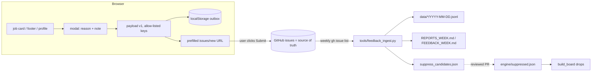

# ADR-009 — One user back channel for reports, feedback, votes and digest (JB-92/93/94)

Status: ACCEPTED for v0 (overnight MVP run, 2026-10-19; BT can reverse) · Issues: #245 (JB-92), #246 (JB-93), #247 (JB-94)
Labels: ✅ verified (how) · ⚠️ inferred · ❓ unchecked.
(The overnight plan called this "ADR-007"; that number is taken by ADR-007-coverage-census, and ADR-008 is Eluta, so this is ADR-009.)

## Context
JB-93 (per-job report), JB-94 (missing company, feedback, thumbs) and JB-92 (digest) each say "write to a tiny endpoint". The decision has to be made **once**, because all three share the channel.

Hard constraints found on `main`:
1. ✅ **CSP (#238)** in `site/index.html`: `connect-src 'self' https://attsis.goatcounter.com; form-action 'none'`. The page **cannot** `fetch()`/POST to any third-party endpoint, and forms can't submit. Any send must be a **top-level navigation** the user clicks (a link opening a new tab). Loosening the CSP would weaken the privacy promise ("the browser enforces that CV text can't be sent anywhere").
2. ✅ **`sweep.yml` deploys production** (ADR-006). It is off-limits for this run, so no ingest step can be added there.
3. ✅ The Action never commits data back (CLAUDE.md: push conflicts).
4. ✅ **No signup is possible tonight**: GoatCounter isn't created (JB-82), and there is no email provider. BT has to do both.
5. ⚠️ GitHub ignores `labels=` on `/issues/new?…` for non-collaborators (GitHub docs behaviour; ❓ not re-tested tonight). The existing footer link's `type:bug` label only sticks for BT.

## Options
| | Works tonight (no signup) | CSP unchanged | Unique-user signal | Spam/abuse | Privacy | Cost |
|---|---|---|---|---|---|---|
| **A. Prefilled GitHub issue + machine block in body (chosen)** | ✅ | ✅ (navigation) | ✅ issue author login | GitHub's own anti-spam | Public, so **never CV data**; user sees the exact text before submitting | $0 |
| B. Cloudflare Worker + KV endpoint | ✗ (account) | ✗ (`connect-src` += worker) | anon id only (spoofable) | ours to build | Server we must run + secure | ~$0, but a backend |
| C. GoatCounter events | ✗ (site not created) | ✅ | ✗ counts only | n/a | ✅ | $0 |
| D. Email (`mailto:` / provider) | ✗ | ✅/✗ | ✗ | inbox spam | Publishes BT's address | provider signup |
| E. Google Form | ✅ | ✅ (navigation) | ✗ | weak | Google | $0, a second system to read |

**Why A:** it is the only option that works tonight without loosening the CSP or running a server, and the issue author gives a free, hard-to-fake **unique-reporter** signal (JB-93's "≥3 unique users" rule). **Cost:** reporters need a GitHub account. That's fine for the group-usable MVP (a tech-leaning audience). Users without an account can still copy the report text. **Revisit (→ B)** when non-GitHub users matter; the payload schema below is transport-agnostic, so only the sender changes.

## Decision

### D1. Transport
The browser builds a prefilled `https://github.com/Arvint89/Attsis-jobboard/issues/new?title=…&body=…` URL and opens it in a new tab **on the user's click**. Nothing is sent until they press "Submit new issue" on GitHub.

### D2. Payload: one fenced block per issue, versioned
````
```attsis-feedback
{"v":1,"kind":"report","reason":"link_404","url":"https://…","company":"Acme","title":"Firmware Engineer","job":"acme|firmware engineer","ts":"2026-10-19T03:12:00Z"}
```
````
The human text goes above the block. **Ingest reads only the block**, so labels and titles are irrelevant (constraint 5).

| kind | required | optional | caps |
|---|---|---|---|
| `report` (JB-93) | `reason` ∈ {`link_404`,`already_closed`,`cannot_apply`,`wrong_title_vs_body`,`wrong_location`,`other`}, `url` (or `job` key when the posting has no link), `company` | `title`, `job`, `note` | note ≤ 500 |
| `company` (JB-94) | `name` | `careers_url`, `city`, `seen_days` (int 0–365) | name ≤ 120 |
| `feedback` (JB-94) | `text` | `area` ∈ {`board`,`map`,`profile`,`tracker`,`other`} | text ≤ 1000 |
| `votes` (JB-94) | `votes`: [{`company`,`url`,`v`∈{1,-1}}] | — | ≤ 40 items |

All kinds carry `v` and `ts`. **Allow-list of keys:** anything else is dropped at ingest, and the browser builders only read job/company fields, **never `PROFILE`** (tested). URLs must be http(s) (reuses the #234 rule). The whole issue URL is kept ≤ 7500 chars ⚠️ (GitHub's practical limit is ~8 k).

### D3. Browser state (localStorage, per browser)
- `jobboard_outbox`: every payload the user opened, `{id, kind, payload, opened_at}`, capped at 50. It powers "Reported ✓" on the card (no double reports) and a "copy text" fallback. It never auto-sends (the CSP forbids it).
- `jobboard_votes` (exists, #204): unchanged. "Share my 👍/👎" batches them into one `votes` issue.

### D4. Action-side ingest (new workflow, not the sweep)
`.github/workflows/feedback-ingest.yml` runs weekly (Mon) plus a manual button. `permissions: {issues: read, contents: read}`.
`gh issue list --state all --search "attsis-feedback in:body" --json number,author,createdAt,body` → `python tools/feedback_ingest.py` →
- `data/reports/YYYY-MM-DD.jsonl` and `data/feedback/YYYY-MM-DD.jsonl` (gitignored; one line per valid payload, + `issue`, `author`)
- `REPORTS_WEEK.md`, `FEEDBACK_WEEK.md` and `suppress_candidates.json`

These are uploaded as a **workflow artifact**. No commit, no deploy. The issues are the source of truth, so the JSONL is a reproducible cache. The same script runs locally (`--from-gh`) when Claude or BT wants to commit a rollup to `docs/status/`.

### D5. Auto-suppress (JB-93's "≥3 link_404 in 48 h")
`feedback.suppress_candidates()` lists URLs with `link_404` from **≥3 distinct authors** within any 48 h window. **v0 doesn't remove listings automatically.** It writes candidates that a reviewed PR copies into `engine/suppressed.json`, which `build_board` drops. **Why not automatic:** the sweep is production (constraint 2), and three throwaway accounts could hide any job. Revisit when report volume is real.

### D6. Digest (JB-92) v0: browser-only
No email in v0 (no provider and no identity ADR; email would break "CV never leaves the browser"). The browser remembers the job ids it has seen (`jobboard_seen`, `jobboard_last_visit`). On load it marks **New** cards and offers a bookmarkable `#new` view of matches new since the last visit. While a tab stays open it re-checks `data/jobs.json` (same origin, CSP-allowed) every 30 min and shows "N new matches — show". **v1 (email, BT signup)** needs a provider (Resend/Buttondown), CASL unsubscribe, a stored email + consent, a `connect-src` change or a Worker, and its own ADR.

## Consequences
- ✅ JB-93/94 ship tonight with a real destination; BT reads reports as GitHub issues today.
- The feedback goes into **public** issues, so the UI says so beside every send button and never pre-fills CV data.
- The existing footer "Report a problem" (#204) becomes "Give feedback" (`kind: feedback`).
- **No email field** (JB-94 asked for an optional one): the issue is public, so an email typed there would be published, and collecting one brings in CASL. Revisit together with digest v1.
- GoatCounter events (#204) stay as they are, with no change; they're counts, not the channel.
- Moving to B later = replace `openFeedback()` with a POST + CSP edit. The schema and ingest stay.



## BT actions (none block v0)
1. Optional: create labels `feedback:report|company|general|votes` (ingest doesn't need them).
2. For digest v1: choose an email provider and sign up. For JB-82: create GoatCounter `attsis`.
