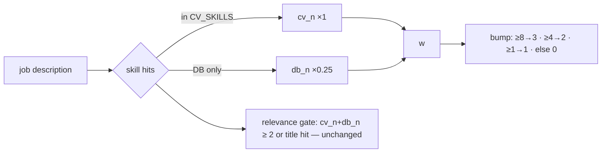

# JB-80 — CV-weighted skill bump (#197, option C)

**Status:** built 2026-10-19 · **Decision:** BT picked option C in the overnight MVP plan.

## Problem
The skill bump counted every canonical skill in the job description (CV ∪ skills DB), so
"skills x30" measured how technical a posting is, not how well it fits *you*. Two users
with different CVs saw near-identical rankings.

## Options (from #197)
| Option | Effect | Risk | Verdict |
|---|---|---|---|
| A. Keep | Score ≈ "is this technical" | No personalisation | ✗ the bug |
| B. CV∩JD only for the bump | Strong personalisation | Sparse CVs crater; big tuning job | ✗ too sharp for one night |
| **C. CV hits ×1, DB-only hits ×0.25** | Smooth: CV dominates, DB still nudges | One extra parameter | ✓ chosen |

Why not B: a CV listing 6 skills could never reach the +3 step; the golden set would need
re-tuning. C keeps the step thresholds (8/4/1) and only changes what counts toward them.

## Contract
```python
# engine/jobfilter.py
CV_SKILLS: frozenset        # profile skill_confirmers, frozen BEFORE the DB widening (JB-50)
DB_SKILL_WEIGHT = 0.25
def skill_bump(cv_hits: int, db_hits: int) -> int:
    w = cv_hits + 0.25 * db_hits
    return 3 if w >= 8 else 2 if w >= 4 else 1 if w >= 1 else 0
```
```js
// site/index.html, SKILLBUMP-PURE block — must equal skill_bump() on every input
function skillBump(cvHits, dbHits) { ... }
```
Reason string: `skills x12 (5 from CV)` (was `skills x12`). `score_explanation()` reads both forms.

**Unchanged:** the relevance gate (title hit or ≥2 skills, CV ∪ DB) — so nothing new is
excluded and recall holds. Titles, seniority, gap, power, commute rules untouched.



## Acceptance
- [x] `tests/test_scoring_jb80.py`: bump table, CV-beats-DB, reason format, **node parity grid** (Python ≡ browser).
- [x] Golden set `tests/test_scoring_golden.py` (BT's sweep 7+ roles) still ≥ 7; off-profile still < 7.
- [x] Full suite + smoke 26/26.

## Follow-ups (not in this PR)
- Titles still use CV ∪ DB for the base score (5 vs 2). Same treatment could apply; needs its own golden check.
