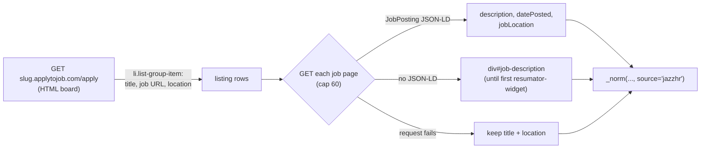

# JB-87 — JazzHR adapter (applytojob.com)

Issue: #217 · Status: built 2026-10-12 · Labels used below: ✅ verified (how) · ⚠️ inferred · ❓ unchecked

## 1. Problem

Six companies kept showing up in the sweep's AUTO-PROMOTE notices with a JazzHR sample URL
(`<slug>.applytojob.com`). We had no adapter, so they could never be added to the registry.
Two of them are strong fits for the sample profile: Myant (textile wearables / ECG) and
Intellijoint Surgical (surgical navigation, Kitchener).

## 2. What JazzHR exposes (✅ fetched from this PC, 2026-10-12)

| Endpoint | Result |
|---|---|
| `/apply` (board) | 200 HTML; title + URL + location per job; **no** description or date |
| `/apply/<id>/<slug>` (job page) | 200 HTML; usually a `JobPosting` JSON-LD block (description, datePosted, location) |
| `/apply/jobs/feed` | 404 |
| JazzHR REST API | needs the **employer's** API key → not usable |
| `app.jazz.co/widgets/basic/create/<slug>` | 200 HTML; same fields as `/apply` |

✅ 13 of 42 live job pages (Carbon Engineering, Parity, RateHub, Intellijoint) had **no** JobPosting
JSON-LD, only an Organization block. Their description is in `div#job-description`.

## 3. Options

| | A. Listing only | **B. Listing + job page (chosen)** | C. Official API | D. Jazz widget |
|---|---|---|---|---|
| Description for scoring | ✗ none (title-only scoring) | ✓ full | ✓ | ✗ |
| Posted date (freshness) | ✗ | ✓ when JSON-LD present (29/42) | ✓ | ✗ |
| Requests per company | 1 | 1 + N (capped at 60) | 1 | 1 |
| Access | public | public | employer key | public |
| Breaks if markup changes | listing parse | listing parse; JSON-LD is a stable schema.org contract | — | widget parse |

**Decision: B.** The scorer is description-driven, so a title-only job (A, D) scores as
"keyword-only" at best. It's the same shape as the BambooHR adapter, which also fetches a list and
then each job's details (JB-19). C is impossible without the employer's key.

**Why not A first and enrich later?** JB-52 thin-JD enrichment exists as an idea, but it isn't built.
B costs ~5–9 s per company (✅ measured: 2.3–8.7 s for 2–12 jobs), which is fine for 6 companies
in a nightly sweep.

## 4. Guards
- `JAZZHR_MAX_DETAILS = 60`: a large board still lists every job, but only the first 60 get a
  job-page fetch (bounded sweep time).
- A failed job-page request keeps the listing title + location (never drops a job).
- `detect_ats`: `*.applytojob.com` → `jazzhr`. `*.applytojobs.ca` is a **different** platform
  (no JSON-LD, 1–2 jobs per board, 5 companies) → not claimed; follow-up if worth it.

## 5. Promotion-tool fixes found while doing this
1. **Canada share came from our pool, not the company's board.** RateHub (Toronto) and Carbon
   Engineering (Squamish, BC) had **0 roles in the current pool**, so the share was 0% and they
   were held back as "foreign". Now `canada_share(fetched_jobs)` uses `facets.country` on the
   live-fetched jobs (the same rule the board uses).
2. **HQ city** falls back to the most common "City, Region" on the company's own board.
3. **A per-platform run overwrote the day's full report.** `--only-platform jazzhr` now writes
   `PROMOTION_<date>_jazzhr.md`.

## 6. Result (✅ live, 2026-10-12)

| Company | Jobs | With description | Dated | Outcome |
|---|---|---|---|---|
| Myant | 12 | 12 | 12 | added (Mississauga) |
| RateHub.ca | 11 | 11 | 8 | added (Toronto; 9/11 "Remote") |
| Carbon Engineering | 9 | 9 | 3 | added (Squamish) |
| Parity | 5 | 5 | 3 | added ⚠️ (1 Toronto, 2 New York, 2 Remote: passes the 50% rule only via "Remote") |
| Intellijoint Surgical | 3 | 3 | 2 | added (Kitchener) |
| A&K Robotics | 2 | 2 | 1 | rejected by the slug check (`aandkrobotics` ≠ "A&K"), a false negative, left as-is |

## 7. Acceptance
- [x] Unit tests from real HTML shapes, no network (`tests/test_adapter_jazzhr.py`, 7 tests)
- [x] `detect_ats` returns jazzhr for applytojob.com, not for applytojobs.ca
- [x] Live: 6/6 boards return jobs; 42/42 with descriptions
- [x] pytest + smoke green
