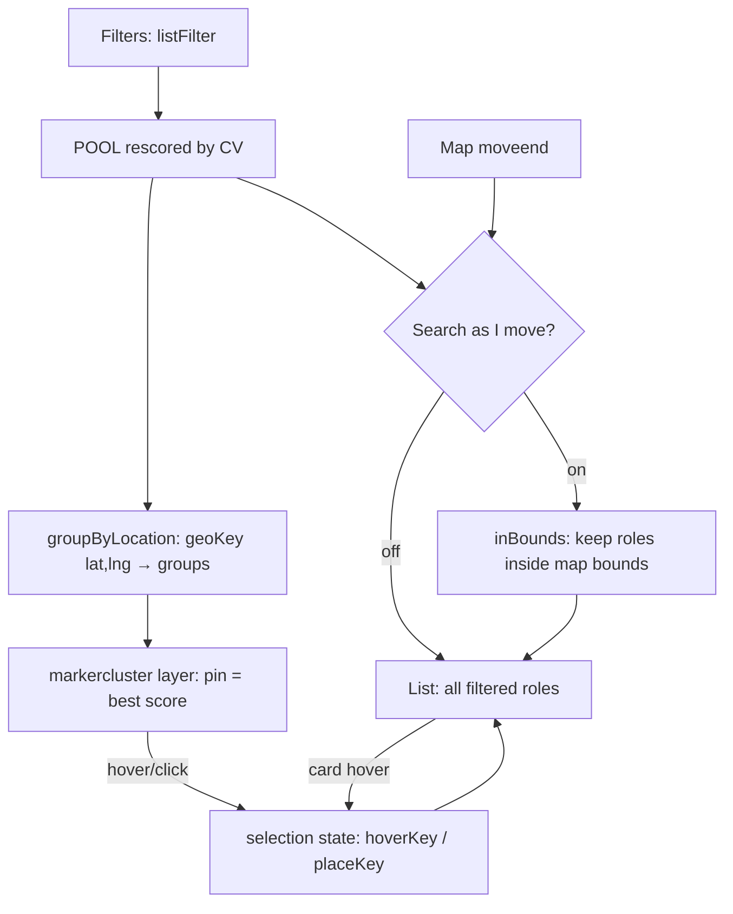

# DESIGN: Map v2 (JB-72, #180)
_v1 · 2026-10-11 · Status: approved scope, building · Labels: ✅ verified (how) · ⚠️ inferred · ❓ unchecked_

## 1. Problem
The map doesn't help people decide where to apply. Today (✅ `site/index.html`, 2026-10-11):
- List and map are **separate tabs** (`#tabList` / `#tabMap`), so you can't see both at once.
- One plain dot per **company** (`L.circleMarker`). You click it to learn anything; no score is visible.
- Light-gray tiles clash with the cosmic-navy site palette (tokens ported in #141).
- No clustering, no viewport filtering, no link between card and pin, and no distance rings drawn.

Users compare it with Airbnb / HouseSigma, where the map **is** the search (⚠️ BT's feedback).

## 2. Data we have (✅ live `jobs.json`, sweep 2026-10-09)
| Field | Coverage |
|---|---|
| per-job `lat`/`lng` | **1,241 / 1,763 (70 %)** |
| per-job `km` / `ring` | 1,177 / 1,422 |
| company `lat`/`lng` | 191 / 191 |
| `home_coords` | **null**, so the site falls back to London (42.9849, −81.2453) |

522 jobs (30 %) can't be placed. That's a data problem, handled in Phase B (location normaliser), **not** hidden.

## 3. Decisions (options → tradeoffs → choice)

### D1. What is a pin?
| Option | Pros | Cons |
|---|---|---|
| A. One per company (today) | 191 pins, every company visible | Score hidden; a multi-city company sits in one place |
| **B. One per location, showing the best score there** (prototype v6) | Score visible at a glance (Airbnb's price pin); matches where the job actually is | Jobs without coordinates can't be pinned |
| C. One per job | Most precise | 1,241 overlapping pins; same coordinates stack |

**Choice: B.** The pin label is the best score at that spot, and the tooltip lists the top 4 roles. **Why not A:** the score is the product's value, so hiding it behind a click wastes the map. **Why not C:** identical coordinates stack into an unreadable pile.

### D2. Layout
| Option | Pros | Cons |
|---|---|---|
| A. Tabs (today) | Simple, mobile-friendly | Can't compare list ↔ map |
| **B. Three modes: List · Split · Map**, default **Split on desktop ≥ 1100 px**, List on mobile | Airbnb pattern on desktop; mobile stays usable | More layout code |
| C. Always split | One layout | Unusable on phones |

**Choice: B**, remembered per browser (localStorage).
Built-in refinements found during the visual check (2026-10-11):
- **Filters moved into the list column** (as in the prototype), so in Split the map starts level with the filters and fits on screen. In Map mode the filter bar stays visible.
- **The page widens to 1400 px** in List + map / Map (two columns need the room), and goes back to 1020 px for List and the other tabs.

### D3. Overlapping pins
| Option | Pros | Cons |
|---|---|---|
| A. None | No code | Toronto / KW / London pile up at zoom ≤ 8 (✅ seen in prod) |
| **B. Leaflet.markercluster 1.5.3** (cdnjs ✅ HTTP 200), cluster bubble shows **count + best score** | Battle-tested, handles zoom/spiderfy | +1 CDN dependency (~40 KB ⚠️) |
| C. Our own grid bucketing | No dependency | Reinvents spiderfy and animation; more bugs |

**Choice: B.** **Why not C:** clustering edge cases (spiderfy, zoom animation) are solved problems. **Fallback:** if the CDN fails, pins render unclustered (feature-detect `L.markerClusterGroup`).

### D4. Tiles
**Choice: Esri World Dark Gray Base + Reference labels** (✅ tile HTTP 200), as in the prototype. **Why not light gray:** it clashes with the dark site. **Why not a Mapbox/vector style:** needs an API key and has usage costs. Esri canvas tiles are already in use with no key.

### D5. "Search as I move the map"
| Option | Pros | Cons |
|---|---|---|
| A. Always on | Pure Airbnb | 522 unplaceable jobs silently vanish from the list |
| **B. Opt-in toggle** (prototype) + an honest count: "N roles outside the map · M with no location" | No silent loss | One extra click |

**Choice: B.**

### D6. List ↔ map sync
- Hovering a card highlights its pin (scale + glow). Clicking a pin filters the list to that location, shown as a removable chip "📍 Toronto ✕", and switches Map → Split.
- **Why:** this is what makes the two views one tool instead of two (⚠️ main driver of the Airbnb feel).

### D7. Companies with no matching roles (today's JB-26/JB-36 value)
Kept as an **optional overlay** "Companies with no open match · N" drawn as dashed hollow dots (prototype's "Not tracked yet"). **Why keep it:** it tells a seeker which employers exist nearby even when nothing is open, and that's unique to us (⚠️).

### D7b. First view framing
Fit the map to pins **within 250 km of home** (when there are ≥ 3), not to every pin. **Why:** ✅ live data has pins in the US, UK and India, so fitting all of them zooms out to a world map. The old map did exactly that (see `screenshots/jb72/before_map_live.png`).

### D8. Pin colour scale (prototype tokens)
8+ → `--good` #00E87A · 7 → `--hi` #00D4FF · <7 → `--raised` #1A2540 with `--dim` text. Home = a light pill with a cyan halo. Rings = 50/100/200 km, dashed cyan, labelled.

## 4. Flow


## 5. Contract (pure functions, unit-tested with Node)
Lives in `site/index.html` between `/* MAPV2-PURE-BEGIN */` and `/* MAPV2-PURE-END */` so tests can extract it.

```js
geoKey(lat, lng) -> "43.65,-79.38"            // 2-decimal (~1 km) bucket
groupByLocation(jobs) -> [{key, lat, lng, place, jobs:[...sorted by score desc], best}]
                                               // skips jobs with null lat/lng
pinTier(score) -> 'strong' | 'good' | 'low'   // >=8, ==7, <7
inBounds(job, {s,n,w,e}) -> bool               // false when lat/lng missing
placeCounts(jobs, bounds) -> {inside, outside, unplaced}
```

## 6. Acceptance criteria
- [ ] Desktop ≥ 1100 px opens in **Split**. Mode buttons List / Split / Map work, and the mode persists across reloads.
- [ ] Pins show the best score, coloured per D8. A cluster bubble shows count + best score.
- [ ] Hovering a card highlights its pin. Clicking a pin filters the list with a removable place chip.
- [ ] "Search as I move" on: panning updates the list, and the count line shows inside / outside / no-location.
- [ ] 50/100/200 km rings + home pill are drawn around `home_coords` (or the London fallback).
- [ ] Optional overlay shows companies with no matching roles.
- [ ] If the markercluster CDN fails, the map still renders (unclustered).
- [ ] `pytest` + `engine/smoke_test.py` pass, and the pure-function tests pass under Node.
- [ ] Before/after screenshots in the PR.

## 7. Out of scope (Phase B, separate PR)
- **Location normaliser** in the engine: "2 Locations", "n/a", country-only strings → an explicit `unplaced` reason, and geocoding more cities.
  Target: placeable jobs 70 % → 85 % (⚠️ goal, not measured).
- `home_coords` written by `build_board.py` (it's null today ✅).
- ~~Salary pin mode~~: **built** after checking the prototype (Pins: Fit score | Salary). Locations with no salary show "—".

## 8. Verification (2026-10-11, local server + live `jobs.json`, Edge via Playwright)
| Check | Result |
|---|---|
| Default layout at 1440 px | ✅ List + map |
| Pin click → list filtered + chip | ✅ Toronto → 170 roles; chip clears |
| Search as I move | ✅ 321 roles in view (772 outside, 517 no location) → zoom in → 92 |
| Card hover → pin highlight | ✅ 1 icon highlighted |
| Salary pins | ✅ e.g. "$130–175k", "—" where no salary |
| Not-hiring overlay | ✅ 47 companies |
| Map mode keeps filters | ✅ |
| Layout persists across reload | ✅ |
| Wide container only on Roles | ✅ |
| Mobile 400 px: defaults to List, no horizontal scroll; Split stacks the map above the list | ✅ |
| Page errors | ✅ none |

Screenshots: `docs/design/screenshots/jb72/` (before = live site 2026-10-11, after = this branch, prototype reference).
