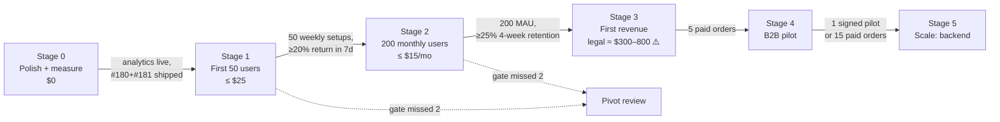

# Growth & Investment Plan: Attsis Job Board
_v1 · 2026-10-11 · Owner: BT · Status: draft for BT review_

> **Rule: every stage has a user gate.** We don't spend the next stage's money or build its features
> until the current stage's gate is met with *measured* numbers. That rule exists because ai-empire spent
> 54k lines of code and $180 on a product with 0 revenue and 0 daily users (✅ `finances/ledger.json`, CMO report 2026-10-10).
>
> Labels: ✅ verified (how) · ⚠️ inferred/estimate · ❓ unchecked.

---

## Where we start (2026-10-11)

| Fact | Label |
|---|---|
| Real users: **unknown**. GoatCounter has never recorded anything (`attsis.goatcounter.com` → HTTP 400) | ✅ curl |
| Live board: 1,763 roles, 191 companies, 2.3 MB `jobs.json` (2026-10-09 sweep) | ✅ live file |
| Static architecture breaks at ~2,000 roles / ~5 MB / ~500 companies | ⚠️ estimate in `docs/COMMERCIALIZATION_RISKS.md` §1 |
| No ToS / Privacy Policy (gate to taking money) | ✅ `COMMERCIALIZATION_RISKS.md` §4.1 |
| Payments not live (`tailor_pay_url` empty) | ✅ `site/data/config.json` |
| Running cost today ≈ $0 (GitHub Pages + Actions free tier) | ⚠️ not checked against the billing page |

**So stage 0 is measurement plus the map/design polish.** Without numbers, no other gate can be checked.

---

## The stages

### Stage 0: Polish + measure (now → ~2–3 weeks ⚠️)
- **Build:** #180 Map v2 and #181 Design parity (P0, in parallel). Minimum measurement: GoatCounter live,
  plus 3 events: `setup_completed`, `job_clicked`, `map_used`.
- **Invest:** $0 · BT 15 min (GoatCounter signup).
- **Gate → Stage 1:** analytics recording ✅ and #180 + #181 merged and checked live.

### Stage 1: First 50 users (soft launch)
- **Get users:** story-led posts (r/cscareerquestionsCAD, r/ECEjobs, r/londonontario, Communitech + London tech groups),
  BT's LinkedIn with a map screenshot. Details in `docs/research/DISTRIBUTION.md`.
- **Build (only what lowers friction):**
  - shareable link per job and per search (so users bring users)
  - 👍/👎 on each match + "Report a problem" (cheap feedback)
  - mobile pass at 400 px
- **Invest:** ≤ $25 ⚠️: custom domain (~$15–20/yr ⚠️) so links look trustworthy. No ads.
- **Gate → Stage 2:** **50 weekly setups completed** and **≥ 20 % come back within 7 days**.
- **If missed twice (2 launch attempts):** pivot review. Is it the audience, the message, or the product? Read the 👎 and problem reports first.

### Stage 2: 200 monthly users (retention + coverage)
- **Build (features that bring people back):**
  - **Coverage:** Ottawa, Montreal, Vancouver, Calgary boards + location cleanup (the 443 jobs with no country, ✅ live file)
  - **Split `jobs.json` per region first.** Expanding coverage crosses the ~2k-role limit ⚠️
  - **"New matches since your last visit"** badge (localStorage, free)
  - **Weekly email/Telegram digest** of new 7+ matches: first feature that needs a sender
- **Invest:** ≤ $15/mo ⚠️ (email-sending service free tier first; pay only above it).
- **Gate → Stage 3:** **200 monthly active users** and **≥ 25 % 4-week retention**.

### Stage 3: First revenue
- **Turn on offer 1:** $17.99 tailored CV + cover letter, $44.99 P.Eng-reviewed (`COMMERCIALIZATION_PLAN.md`):
  Stripe payment link → intake form (#135) → manual fulfilment by BT.
- **Invest:** ToS + Privacy Policy + one legal consult, ≈ $300–800 ⚠️ (required before taking money, risks doc §4.1/§6). Stripe fees per sale only.
- **Gate → Stage 4:** **5 paid orders** (= commercialization plan gate A).
- **If missed:** test a cheaper offer ($8.99) or an interview-prep call, per the commercialization plan §5.

### Stage 4: B2B pilot (the real business)
- **Pitch:** a regional board licence to LEDC, Invest Ottawa, Western, Fanshawe, Waterloo co-op:
  60-day free pilot, then $197.99/mo. **Bring Stage 1–2 usage numbers as proof.**
- **Build:** region + branding config (`?tenant=`), a weekly usage report for the partner.
- **Invest:** BT's time for meetings; a 5-slide deck.
- **Gate → Stage 5:** **1 signed pilot** or **15 paid orders total**.

### Stage 5: Scale
- **Build:** a backend (accounts, cross-device sync, alerts), only now, because paying users justify running costs.
- **Invest:** hosting $20–50/mo ⚠️, sized to actual revenue.

---

## Investment summary

| Stage | Users gate (to leave) | Cash | Main build |
|---|---|---|---|
| 0 | analytics live + #180/#181 | $0 | Map v2, design, minimal analytics |
| 1 | 50 weekly setups, 20 % 7-day return | ≤ $25 | share links, 👍/👎, mobile |
| 2 | 200 MAU, 25 % 4-week retention | ≤ $15/mo | regions, digest, data split |
| 3 | 5 paid orders | ≈ $300–800 legal ⚠️ | payments, intake, ToS/Privacy |
| 4 | 1 pilot or 15 orders | ~$0 | tenant config, partner report |
| 5 | revenue covers hosting | $20–50/mo ⚠️ | backend |

**Weekly ritual (10 min, every Monday):** record visits, setups, 7-day return, 👍/👎 counts,
orders and their source in `docs/status/WEEKLY_METRICS.md`. A gate can only be passed with numbers from this file.

## Open questions for BT (❓)
1. Are the gate numbers right for a regional niche, or should Stage 1 be 25?
2. Weekly digest channel: email or the existing Attsis Daily Telegram bot (ai-empire)?
3. Monthly cash ceiling you're comfortable with before revenue?
